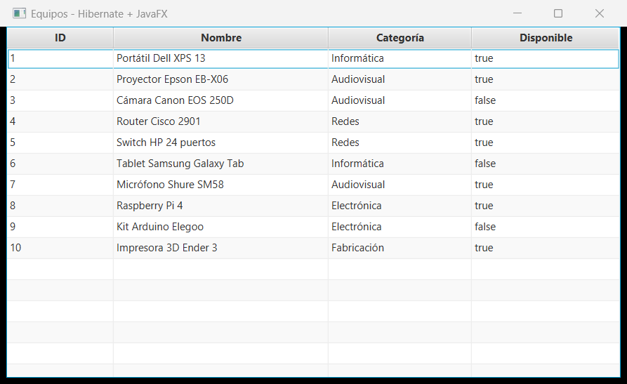

# HelloHibernateG1 – JavaFX + Hibernate

Ventana JavaFX con un `TableView` que muestra todo el contenido de la tabla `Equipo` (MySQL en Docker, acceso con Hibernate).

## Ejecutar
```
docker compose up -d      # MySQL en localhost:3307, crea BD "ad" y tabla Equipo con datos (docker/init.sql)
mvn javafx:run
```

